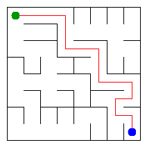

# Assignment 3. Maze Escape

- **Student ID:** 242384
- **Name:** Askar Bavgashev
- **Group:** SE-2540
- **Maze size (rows x columns):** 8 x 8

This project implements the maze algorithms in Java 17 using a custom disjoint-set structure and standard Java collections. The personal input files were generated with `java tools/MakeVariant.java 242384 data`.

## Program output

Output from `java -cp out Main` on this student's data:

```text
Broken: 63
Kept: 49
Last broken wall: 91
MST cost: 19945
Heaviest broken wall: 816
Path length: 16
DFS visited: 29
Dead ends: 20
Zones: 10
Largest zone: 15
Is DAG: 0
Flow stages: 6
Fastest route cost: 1
```

## My maze



Open [`output/maze.html`](output/maze.html) in a browser to inspect the maze and use the arrow keys to walk through it.

## Questions

**Mission 0. What do `find` and `union` do, and what makes them fast in your code?**

`find` returns the representative of the set containing a cell. `union` combines two sets and returns `false` if they are already connected. Union by size keeps the trees shallow, and path compression makes later `find` operations faster; together their amortized time is almost constant, formally O(α(n)).

**Mission 1. Why is Broken always R*C - 1, and Kept always (R-1)*(C-1)?**

There are R*C cells, and the maze starts with every cell separate. Each broken wall joins two different components, reducing the number of components by exactly one, until all cells are connected; therefore exactly R*C - 1 walls are broken. The grid has (R-1)C + R(C-1) = 2RC-R-C inner walls, so the number kept is 2RC-R-C-(RC-1) = RC-R-C+1 = (R-1)(C-1).

**Mission 2. My MST cost from Kruskal and from Prim, and why they are equal:**

Kruskal's MST cost is **19945**, and Prim returns the same cost, **19945**. Both algorithms find a minimum spanning tree of the same connected weighted graph; the minimum spanning tree's total cost is independent of which correct algorithm finds it.

**Mission 3. Why is there exactly one path between two cells? How did you avoid a stack overflow on a huge maze?**

Mission 1 adds an edge only when it connects two previously separate components, so the final connected graph has no cycles and is a tree. In a tree there is exactly one simple path between any pair of vertices. The DFS uses explicit arrays as a stack instead of recursive method calls, so a long search path does not overflow the Java call stack.

**Mission 4. Why does the second pass of Kosaraju go on the reversed graph? Why do the slides have no cycle exactly when Zones equals the number of cells?**

The first DFS pass records vertices by finishing time. Processing them in reverse finishing order on the reversed graph isolates one strongly connected component at a time, and the components receive topological numbers. A directed cycle with more than one vertex places those vertices in the same strongly connected component; therefore every cell is its own component exactly when there are no directed cycles (self-slides are disallowed in this input).

**Mission 5. Why is it enough to go through the zones in the order of their numbers? What does this pass cost?**

After contracting each strongly connected component, the zone graph is a DAG, and Kosaraju's numbering puts every cross-zone edge from a smaller number to a larger number. Processing zones in that order therefore guarantees that all possible predecessor distances and longest-chain values are ready before a zone is processed. Building the zone graph and processing its edges takes O(S + Z + E), where S is the number of slides, Z the number of zones, and E the number of distinct cross-zone edges.

## AI use

ChatGPT was used to help implement and review the algorithms, prepare explanations, and check the program against the supplied examples. The code and report should be reviewed and understood by the student before submission, in accordance with the assignment rules.

## Timing (Mission 7)

Milliseconds, 5 runs each, measured with `java -Xmx2g -cp out Bench` on this environment. Times can vary with hardware and system load.

| Maze | Kruskal average (ms) | Prim average (ms) |
|---|---:|---:|
| 100 x 100 | 15 | 25 |
| 300 x 300 | 141 | 139 |
| 1000 x 1000 | 1489 | 3320 |

The runtime grows as the maze gets larger because the number of cells and walls grows substantially. Kruskal sorts all walls, while Prim maintains a priority queue of candidate edges; in this run Prim was faster on the 300 x 300 maze but slower on the 1000 x 1000 maze. These are measurements from one machine, not guaranteed runtimes.

## Complexity

Let `n` be the number of cells, `m` the number of walls, `s` the number of slides, `z` the number of zones, and `e` the number of distinct edges between zones.

| Algorithm | Time | Space | Assumptions |
|---|---|---|---|
| DSU `find` / `union` | O(α(n)) amortized per operation | O(n) for the structure | Union by size and path compression |
| Mission 1 wall building | O(m α(n)) | O(n) auxiliary, O(n) result | Walls processed in file order |
| Kruskal | O(m log m + m α(n)) | O(n + m) including sorted edge indexes | Connected undirected maze graph |
| Prim | O((n + m) log m) | O(n + m) | Adjacency lists and priority queue |
| Iterative DFS escape | O(n + m) | O(n + m) | Each cell is visited at most once |
| Kosaraju SCC | O(n + s) | O(n + s) | Both graph directions are available |
| Route in zone graph | O(s + z + e) expected | O(z + e) | Zone numbers are topological; hash-map operations are expected O(1) |

## Checks

Run these commands from the project directory:

```bash
javac -d out src/*.java
java -cp out DisjointSetTest
java tools/Check.java
java -cp out Main
java -Xmx2g -cp out Bench
```

`java tools/Check.java` compiles the code and verifies all 13 output lines for the `tiny`, `small`, and `dag` examples. The test suite and all three examples passed during preparation.

## Submission note

This copy intentionally has **one Git commit**, as requested. The assignment sheet asks for at least seven commits, so this choice may lose the Git-history points.
